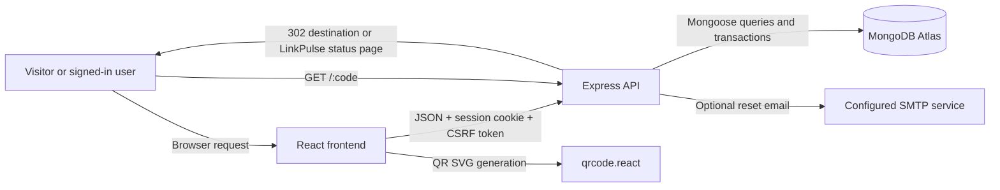
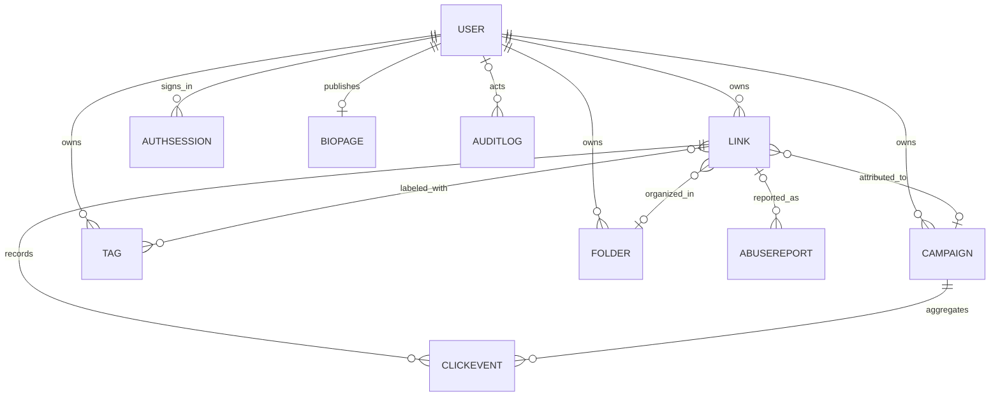

# LinkPulse

**Shorten links. Understand every click.**

LinkPulse is a URL shortener and analytics workspace for individuals and teams. It pairs a React dashboard with a Node.js API and MongoDB persistence for links, campaigns, accounts, and click events.

[](https://react.dev/)
[](https://vite.dev/)
[](https://nodejs.org/)
[](https://expressjs.com/)
[](https://www.mongodb.com/)

> No LinkPulse-specific live demo or canonical repository URL is published from this workspace.

## Contents

- [Overview](#overview)
- [Screenshots](#screenshots)
- [Features](#features)
- [Technology stack](#technology-stack)
- [Architecture and request flow](#architecture-and-request-flow)
- [Project structure](#project-structure)
- [Prerequisites](#prerequisites)
- [Local setup](#local-setup)
- [Environment variables](#environment-variables)
- [Usage](#usage)
- [API](#api)
- [Data model](#data-model)
- [Security and privacy](#security-and-privacy)
- [Testing and troubleshooting](#testing-and-troubleshooting)
- [Production deployment](#production-deployment)
- [Roadmap](#roadmap)
- [Contributing](#contributing)
- [License](#license)
- [Author and contact](#author-and-contact)

## Overview

Long URLs are difficult to share and provide little insight into how they are used. LinkPulse lets a signed-in user create a short link, manage its lifecycle, organize it by campaign or folder, and review analytics derived from recorded clicks. Administrators have separate tools for user management, abuse reports, blocked domains, and platform-level reporting.

The application has a React single-page frontend, an Express JSON API, and MongoDB persistence. It is intended for developers exploring a full-stack link-management product and for users who need link organization and click reporting. A MongoDB replica set is required for transaction-backed click and multi-record operations.

## Screenshots

Screenshots are not included in the repository. Capture the actual application, save images under `docs/screenshots/`, and add relative Markdown image links here when they are available.
<!-- Screenshot placeholder: save a real dashboard capture to docs/screenshots/dashboard.png before adding a rendered image. -->

## Features

### Link management

- Create links with generated or custom aliases, titles, campaigns, folders, and tags.
- Validate destination URLs and reject non-HTTP(S) schemes and embedded credentials.
- Search, filter, sort, paginate, edit, and disable owned links.
- Configure expiry, maximum clicks, password protection, and QR display.
- Preserve disabled/expired link records and click history.
- Import CSV rows independently and receive per-row success or validation errors.

### Analytics and organization

- Aggregate click trends, visitor estimates, referrers, devices, browsers, top links, and campaign performance.
- Filter reports by date range, campaign, or link.
- Organize links into campaigns, tags, and folders.
- Create a public link-in-bio page with enabled links.
- Generate QR SVGs in the frontend with `qrcode.react`; the API provides the corresponding short-link metadata.

### Accounts and administration

- Register, sign in, sign out, restore the current session, and request/reset passwords.
- Update account profile and preferences.
- Restrict workspace resources to their owner.
- Protect administrative screens and APIs with an admin-role check.
- Review users, links, abuse reports, blocked domains, platform settings, and audit history.

### User experience

- Dark-first responsive React interface with dashboard, public, account, workspace, and admin routes.
- Client-side loading, error, and empty states for API-backed pages.
- Shared navigation, reusable UI components, charts, and forms.

The marketing analytics preview uses illustrative data and is presented as a preview. Authenticated dashboard and administrative metrics are fetched from the API; they do not silently fall back to mock metrics. SMTP delivery and public production hosting require deployment-specific configuration.

## Technology stack

| Area | Technology | Role |
|---|---|---|
| Frontend | React 18, JavaScript, Vite 6 | Single-page user interface and development/build tooling |
| Routing and icons | React Router 7, Lucide React | Client-side routes and interface iconography |
| Styling and charts | Custom CSS, Recharts | Responsive visual system and analytics charts |
| QR codes | `qrcode.react` | Client-side QR SVG generation |
| API | Node.js, Express 5 | REST-style JSON endpoints and short-link redirects |
| Validation and middleware | Zod, Helmet, CORS, `express-rate-limit`, `cookie-parser` | Request validation and HTTP/security middleware |
| Persistence | MongoDB Atlas, Mongoose 9 | Account, link, campaign, click, and platform data |
| Logging and email | Pino, Nodemailer | Structured application/request logs and optional SMTP password-reset mail |
| CSV | Papa Parse, Multer | CSV parsing and bounded in-memory upload handling |
| Tests and lint | Node.js test runner, Supertest, ESLint 9 | Backend/API tests and JavaScript/JSX linting |

Versions above reflect the project manifest; installable patch versions are resolved by `package-lock.json`.

## Architecture and request flow

The development runner starts the Vite frontend and API together, selecting available ports and coordinating the frontend API URL and API CORS/redirect origins. The frontend sends credentialed requests to the API. Mutating requests obtain a CSRF token and include it with the HTTP-only session cookie. The API validates requests, checks ownership/role, and reads or writes MongoDB through Mongoose.



For a counted human redirect, the API conditionally increments the link click counter and creates a click event inside a MongoDB transaction. A disabled, expired, taken-down, or click-capped link does not redirect to its destination. Known crawler/preview user agents are allowed to resolve the destination without consuming the click cap or adding analytics events.

## Project structure

```text
.
├── frontend/
│   ├── index.html
│   ├── vite.config.js
│   └── src/
│       ├── components/       # App shell, charts, tables, shared UI
│       ├── context/          # Authenticated workspace state
│       ├── data/             # Illustrative marketing-preview data
│       ├── pages/            # Public, workspace, and admin pages
│       ├── services/         # Central credentialed API client
│       ├── styles/           # Global design system and responsive styles
│       ├── App.jsx
│       └── main.jsx
├── backend/
│   ├── config/               # Environment, MongoDB, and logger setup
│   ├── .env.example          # Safe backend environment template
│   ├── middleware/           # Authentication, validation, security, errors
│   ├── models/               # Mongoose schemas and indexes
│   ├── routes/               # Auth, links, analytics, resources, admin, redirect
│   ├── scripts/              # Development seed and production admin bootstrap
│   ├── services/             # Domain logic, aggregation, mail, audit logging
│   ├── tests/                # API/security unit tests and DB lifecycle test
│   ├── utils/
│   ├── validators/
│   ├── API.md                # Route/configuration reference
│   ├── app.js
│   └── server.js
├── scripts/dev.js            # Combined frontend/API development runner
├── .env.example              # Safe frontend build/development defaults
├── .gitignore                # Ignores local secrets and generated files
├── eslint.config.js
├── package.json
├── package-lock.json
└── README.md
```

Local `.env` files, dependencies, and generated build output are ignored by Git.

## Prerequisites

- Windows 10/11 with PowerShell, or another Node.js-compatible shell.
- Node.js `20.19+` or `22.12+`; npm.
- MongoDB Atlas or another MongoDB **replica set** for persistent workflows and transaction-backed operations.
- Atlas database credentials and a Network Access rule allowing the development/deployment host.
- SMTP credentials only if password-reset email delivery is required.

## Local setup

Run these commands from the project root. The copy steps do not overwrite an existing environment file:

```powershell
node --version
npm --version
npm install
if (-not (Test-Path .env)) { Copy-Item .env.example .env }
if (-not (Test-Path backend/.env)) { Copy-Item backend/.env.example backend/.env }
```

Edit `backend/.env` and replace the placeholder `MONGODB_URI` with the Atlas URI and `SESSION_SECRET` with a unique random value of at least 32 characters. URL-encode reserved characters in the database password. Configure the Atlas IP allowlist. Never paste real credentials into `.env.example` or commit them.

Start both services from the root in one terminal:

```powershell
npm run dev
```

The runner prints the actual frontend and API URLs. By default, it prefers `http://localhost:5173` and `http://localhost:4000`, choosing another available port if needed. Open the printed frontend URL. The API readiness endpoint is `/health/ready`.

The two separate commands are available when separate terminals are preferred:

```powershell
# Terminal 1
npm run backend:dev

# Terminal 2
npm run frontend:dev
```

When run separately, set frontend `VITE_API_URL`/`VITE_PUBLIC_SHORT_URL` and backend `FRONTEND_URL`/`CORS_ORIGINS` consistently. A missing or unreachable database is reported as degraded readiness and database-backed requests return `503`; the application does not simulate persistence.

## Environment variables

Backend variables are loaded from `backend/.env` and then the root `.env`. Shell/process environment values take precedence. The checked-in examples contain placeholders and local defaults only: [root `.env.example`](.env.example) and [backend `.env.example`](backend/.env.example).

| Variable | Required? | Purpose / behavior |
|---|---|---|
| `NODE_ENV` | Optional; set in production | `development`, `test`, or `production`; defaults to `development`. Production cookies require HTTPS. |
| `PORT` | Optional | API port; defaults to `4000`. |
| `FRONTEND_URL` | Optional | Frontend origin for redirect-status pages; defaults to localhost port 5173. |
| `CORS_ORIGINS` | Optional | Comma-separated exact allowed origins; defaults to localhost port 5173. |
| `MONGODB_URI` | Required for persistent features | MongoDB Atlas/replica-set URI. Without it, database-backed API routes are unavailable. |
| `SESSION_SECRET` | Required in production | HMAC signing secret; production requires at least 32 characters. Development has a code-provided fallback and must not use it in production. |
| `COOKIE_DOMAIN` | Optional | Cookie domain shared by the UI/API/short-link hosts when needed. |
| `TRUST_PROXY` | Optional | Trusted proxy hop count; defaults to `0`. Set only to the actual deployment topology. |
| `SESSION_TTL_DAYS` | Optional | Session lifetime, 1–90 days; defaults to `14`. |
| `PASSWORD_RESET_TTL_MINUTES` | Optional | Reset-token lifetime, 5–120 minutes; defaults to `30`. |
| `SMTP_HOST` | Optional | SMTP server; required for actual reset-email delivery. |
| `SMTP_PORT` | Optional | SMTP port; defaults to `587`. |
| `SMTP_SECURE` | Optional | `true` or `false`; defaults to `false`. |
| `SMTP_USER`, `SMTP_PASSWORD` | Optional | SMTP authentication credentials. |
| `EMAIL_FROM` | Optional | Reset-email sender address. |
| `PUBLIC_SHORT_DOMAIN` | Optional | Public short-link origin without a path; defaults to `http://localhost:4000`. |
| `SEED_ADMIN_EMAIL` | Optional; development seed only | Email used by `npm run seed:demo`. |
| `SEED_ADMIN_PASSWORD` | Optional; development seed only | Development admin password; minimum 12 characters. |
| `BOOTSTRAP_ADMIN_EMAIL` | Optional; one-time production command only | Initial admin email for `npm run admin:bootstrap`. |
| `BOOTSTRAP_ADMIN_PASSWORD` | Optional; one-time production command only | Initial admin password, 12–128 characters. Remove from the shell environment immediately after bootstrapping. |
| `VITE_API_URL` | Optional frontend setting | API origin embedded in the frontend build; defaults to `http://localhost:4000`. |
| `VITE_PUBLIC_SHORT_URL` | Optional frontend setting | Short-link origin displayed/copied by the UI; defaults to the API origin. |
| `VITE_PORT` | Optional development-runner setting | Preferred Vite port; defaults to `5173`. |

`MONGODB_USERNAME` and `MONGODB_PASSWORD` are not separate application settings; provide credentials inside `MONGODB_URI`.

## Usage

1. Open the frontend URL printed by `npm run dev`.
2. Register an account or sign in. The API sets a session cookie; account and workspace state is fetched from MongoDB-backed endpoints.
3. Create a link with an HTTP(S) destination. Optionally set an alias, expiry, click cap, password, campaign, tags, folder, and QR display.
4. Copy/open the returned short URL. Human clicks are recorded and become available in analytics; crawler/preview traffic is excluded by the user-agent heuristic described below.
5. Edit or disable a link, import a CSV, or manage campaigns, tags, folders, QR codes, bio pages, and profile preferences.
6. Admin-only operations require a seeded development admin or the one-time production admin bootstrap. Public registration cannot assign roles.

### Example API request (PowerShell)

The API requires a CSRF token on every mutating `/api` request. `WebRequestSession` preserves the CSRF and session cookies:

```powershell
$api = 'http://localhost:4000'
$session = New-Object Microsoft.PowerShell.Commands.WebRequestSession
$csrf = Invoke-RestMethod -Uri "$api/api/auth/csrf" -WebSession $session
$headers = @{ 'X-CSRF-Token' = $csrf.csrfToken }

$registration = @{
  name = 'Example User'
  email = 'you@example.com'
  password = 'replace-with-a-unique-password'
} | ConvertTo-Json

$account = Invoke-RestMethod -Uri "$api/api/auth/register" `
  -Method Post -ContentType 'application/json' -WebSession $session `
  -Headers $headers -Body $registration

$linkBody = @{
  destination = 'https://example.org/article'
  title = 'Example article'
} | ConvertTo-Json

$link = Invoke-RestMethod -Uri "$api/api/links" `
  -Method Post -ContentType 'application/json' -WebSession $session `
  -Headers $headers -Body $linkBody

$link.link.shortUrl
```

The password above is a placeholder; use a unique value for local testing. Registration requires a password of at least 12 characters. Link creation accepts fields documented in [the API reference](backend/API.md).

## API

Base API origin defaults to `http://localhost:4000`. JSON routes return structured errors shaped like `{ "error": { "code", "message", "details?", "requestId" } }`. Authentication uses an HTTP-only `lp_session` cookie; all mutating `/api` routes also require the `lp_csrf` cookie and matching `X-CSRF-Token` header.

| Method | Route | Access | Purpose |
|---|---|---|---|
| `GET` | `/health` | Public | Liveness and observed database configuration/connection state. |
| `GET` | `/health/ready` | Public | Readiness; returns `503` while MongoDB is unavailable. |
| `GET` | `/api/auth/csrf` | Public | Issue a CSRF cookie/token. |
| `POST` | `/api/auth/register` | Public + CSRF | Create a regular account and session. |
| `POST` | `/api/auth/login` | Public + CSRF | Authenticate and issue a session. |
| `POST` | `/api/auth/logout` | Public + CSRF | Revoke the current session and clear cookies. |
| `GET` | `/api/auth/me` | Signed in | Restore the current user. |
| `POST` | `/api/auth/password/forgot`, `/api/auth/password/reset` | Public + CSRF | Request/reset password; email delivery requires SMTP. |
| `GET`, `PATCH` | `/api/account/profile`, `/api/account/preferences` | Signed in | Read/update profile and preferences. |
| `GET`, `POST` | `/api/links` | Signed in, owner-scoped | List/search/filter or create links. |
| `GET`, `PATCH`, `DELETE` | `/api/links/:id` | Signed in, owner-scoped | Read/update or disable a link. Delete preserves the record and history. |
| `GET` | `/api/links/alias/:alias/availability` | Signed in | Check global alias availability. |
| `GET` | `/api/links/:id/qr`, `/api/links/:id/analytics` | Signed in, owner-scoped | Get QR URL metadata or link-specific analytics. |
| `POST` | `/api/links/public/:code/unlock` | Public + CSRF | Unlock a password-protected link with a short-lived cookie. |
| `POST` | `/api/links/import` | Signed in + CSRF | Import multipart CSV (`file` field; max 2 MB/1,000 rows). |
| `GET` | `/:code` | Public | Enforce link status/expiry/cap/password rules and redirect or show the relevant UI state. |
| `GET` | `/api/analytics`, `/api/analytics/campaigns/:id` | Signed in, owner-scoped | Read workspace or campaign analytics. |
| `GET`, `POST`, `PATCH`, `DELETE` | `/api/campaigns`, `/api/tags`, `/api/folders` | Signed in, owner-scoped | Manage organization resources. |
| `GET`, `PUT` | `/api/bio` | Signed in, owner-scoped | Read or save the current user's bio page. |
| `GET` | `/api/bio/:slug` | Public | Read a published bio page. |
| `POST` | `/api/reports` | Public + CSRF | Submit a link-abuse report. |
| `GET`, `POST`, `PATCH`, `DELETE` | `/api/admin/*` | Admin + CSRF for mutations | Platform analytics, users, links, abuse reports, blocked domains, settings, and audit logs. |

Create-link JSON requires `destination`; optional fields include `alias`, `title`, `campaignId`, `folderId`, `tagIds`, `expiresAt`, `maxClicks`, `password`, and `qrEnabled`. Analytics accept ISO `from`/`to` ranges up to 366 days and `groupBy=day|week|month`. List endpoints support pagination (`page`, `limit` up to 100).

Detailed endpoint behavior, query validation, redirect states, CSV rules, and admin route list are maintained in [backend/API.md](backend/API.md).

Example successful link response (IDs and dates are server-generated):

```json
{
  "link": {
    "_id": "66a000000000000000000001",
    "userId": "66a000000000000000000002",
    "destination": "https://example.org/article",
    "code": "a1b2c3d4",
    "status": "active",
    "clickCount": 0,
    "shortUrl": "http://localhost:4000/a1b2c3d4"
  }
}
```

The actual short URL origin is configured by `PUBLIC_SHORT_DOMAIN`; development port coordination may select a different API port.

## Data model

MongoDB collections are represented by Mongoose models:

| Model | Main data and relationships |
|---|---|
| `User` | Email, scrypt password hash, role/status, preferences, password-reset state. Owns links and workspace resources. |
| `AuthSession` | User reference, hashed random session token, expiry, user-agent; only sessions have a TTL index. |
| `Link` | Owner, unique short code, destination, status, campaign/folder/tag references, password hash, expiry, maximum/current clicks, QR flag. |
| `ClickEvent` | Link, owner and optional campaign references; timestamp, pseudonymous visitor key, referrer host, device/browser classification and bot flag. |
| `Campaign` | Owner, name, description, status and optional date range; archived campaigns retain their records. |
| `Tag`, `Folder` | Owner-scoped labels and nested folder references used to organize links. |
| `BioPage` | One page per user, unique public slug, publication state, theme and embedded links. |
| `BlockedDomain` | Blocklisted hostnames and administrative attribution/reason. |
| `AbuseReport` | Reported code, optional link reference, reporter details, review state and resolution. |
| `AuditLog` | Actor/target, action, resource, outcome, metadata and timestamp for audited operations. |
| `PlatformSetting` | Platform registration, maintenance and default-link-limit settings. |



Click events are not deleted when a link expires or is disabled. Analytics aggregate these stored events; unique visitors are estimates based on an HMAC of IP address and user agent bucketed by calendar month, not an account-level identity.

## Security and privacy

- Passwords are hashed with Node.js `scrypt`; random session/reset tokens are stored as hashes.
- Authentication uses an HTTP-only session cookie, `SameSite=Strict`, production `Secure` cookies, expiry, and server-side session revocation.
- Mutating API requests require a CSRF token; credentialed CORS uses configured exact origins.
- Zod schemas validate request bodies, path parameters, and query filters. Destinations must be absolute HTTP(S) URLs without credentials; the service does not fetch destinations.
- Owner checks scope user data. Admin APIs require the persisted admin role; public registration does not accept role assignment.
- Express rate limits cover general API requests, authentication, registration, password resets, imports, public reports, and redirects.
- Helmet sets standard HTTP security headers. Pino request logging records method/path/status/request ID rather than request bodies or query strings.
- Click records store no raw IP address. Bot detection uses a user-agent pattern heuristic; it is not a guarantee that every automated client is identified.
- Conditional atomic click-cap updates and click-event writes use MongoDB transactions to avoid over-counting concurrent redirects.
- Expired, disabled, and taken-down links and historical click events are retained; link/click history is not TTL-deleted.

These controls depend on production configuration. Use HTTPS, a unique production `SESSION_SECRET`, exact CORS origins, least-privilege Atlas credentials, a correctly configured trusted proxy, and an approved SMTP service when password-reset email is enabled. This README does not represent an external security certification.

## Testing and troubleshooting

Run from the repository root:

```powershell
npm run lint
npm test
npm run build
npm audit
```

`npm test` runs Node's test runner through `backend:test`. Unit/API security tests run without a database. The database lifecycle test connects when `MONGODB_URI` is configured and otherwise skips; with Atlas configured it exercises registration/login/logout, ownership/admin access, link validation and CRUD, aliases, redirects, expiry, concurrent click caps, password unlock, QR metadata, CSV row results, analytics, bot exclusion, and click-history retention. It creates uniquely named test users and removes only their test-owned records. No frontend component test suite is currently present.

| Symptom | Check |
|---|---|
| `/health/ready` returns `503` | Check `MONGODB_URI`, Atlas credentials/password URL encoding, cluster state, DNS/network access, and Atlas IP allowlist. Restart after environment changes. |
| Transaction/replica-set error | Use Atlas or another replica set. Standalone MongoDB does not support the transactions used by counted redirects and multi-record operations. |
| `EADDRINUSE` | The combined runner selects a free port and prints it; open that exact frontend URL. Inspect listeners with `Get-NetTCPConnection -State Listen`. |
| CORS/CSRF failure | Use the printed frontend origin and keep hostnames consistent (`localhost` versus `127.0.0.1`). The runner coordinates CORS for its selected port. |
| Password reset is not delivered | Configure valid `SMTP_*` values. Empty SMTP configuration does not simulate successful email delivery. |
| Custom alias unavailable | Aliases are globally unique, including aliases belonging to disabled links. |
| Production login cookie is missing | Serve the frontend/API over HTTPS and verify `COOKIE_DOMAIN`, trusted proxy configuration, and same-site hostnames. |

## Production deployment

Production deployment requires real domains/TLS, Atlas network/database setup, a hosting provider, and (if used) SMTP. These external resources are not provisioned by the repository.

1. Set `NODE_ENV=production` in the **production API environment**. Keep `NODE_ENV=development` in the local `backend/.env`; production cookies require HTTPS and do not work on local HTTP origins.
2. Configure exact `FRONTEND_URL` and `CORS_ORIGINS`, `MONGODB_URI`, a random `SESSION_SECRET` of at least 32 characters, `PUBLIC_SHORT_DOMAIN`, and `COOKIE_DOMAIN` for a shared parent domain when frontend/API/short hosts differ. Set `TRUST_PROXY` only to the known reverse-proxy hop count.
3. Use an Atlas replica set, a least-privilege database user, and a restricted Atlas Network Access allowlist. Add production SMTP credentials only if reset email is required.
4. Build the frontend with its public origins set in the deployment/build environment and deploy `frontend/dist/` to an HTTPS static host/CDN:

   ```powershell
   $env:VITE_API_URL = 'https://api.example.com'
   $env:VITE_PUBLIC_SHORT_URL = 'https://go.example.com'
   npm ci
   npm run lint
   npm test
   npm run build
   ```

   The example hostnames above are placeholders, not configured deployment URLs.
5. Run `npm run backend:start` from the repository root under a process manager/container with production backend variables loaded. Route the API and short-link hostnames to the backend, and check `/health/ready` before sending traffic. Configure restart-on-failure and graceful termination.

### First production administrator

`npm run seed:demo` is development-only. For a first production administrator, load the production API configuration into a one-off operator shell and enter a temporary password as a secure prompt:

```powershell
$env:NODE_ENV = 'production'
$env:BOOTSTRAP_ADMIN_EMAIL = Read-Host 'Initial administrator email'
$bootstrapPassword = Read-Host 'Temporary administrator password' -AsSecureString
$env:BOOTSTRAP_ADMIN_PASSWORD = [System.Net.NetworkCredential]::new('', $bootstrapPassword).Password
npm run admin:bootstrap
Remove-Item Env:BOOTSTRAP_ADMIN_EMAIL, Env:BOOTSTRAP_ADMIN_PASSWORD, Env:NODE_ENV
$bootstrapPassword.Dispose()
```

The command requires a ready MongoDB connection, creates an admin only when none exists, refuses to promote an existing user, and claims the bootstrap slot transactionally. Remove bootstrap credentials immediately and require the new administrator to use the password-reset flow before normal use (SMTP must be configured for reset email). Do not run the one-time bootstrap after an admin already exists.

## Roadmap

No separate product roadmap is checked into this repository. Deployment-specific work remains: production domains/TLS, hosting, Atlas access configuration, and SMTP credentials where password resets are required.

## Contributing

1. Fork the repository once its canonical remote URL is published and create a focused branch.
2. Keep changes scoped; do not commit `.env` files, credentials, database exports, `node_modules/`, or build output.
3. Run `npm run lint`, `npm test`, and `npm run build`.
4. Open a pull request with a concise description, validation results, and screenshots for user-visible changes.

## License

No `LICENSE` file or package license declaration is present. The project license has not yet been specified.

## Author and contact

No verified author/contact details or project-specific support URL are configured in this workspace.
